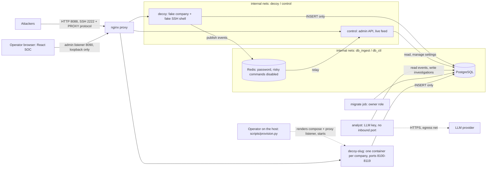

# Architecture

- **Decoy** (`app/decoy.py`, `app/sshpot.py`, `app/shell.py`): serves synthetic company data and a simulated SSH shell. No admin routes, no admin token, no LLM key, no docs endpoint, insert-only DB role, no route to the internet.
- **Control plane** (`app/control.py`): admin API, WebSocket feed, kill switch, retention purge. Shares state with the decoy through the `settings` table (cached 2 s), so a kill takes effect within seconds.
- **Analyst service** (`app/analyst_worker.py`): the only component with egress. Rules provide ground truth; the LLM only writes prose and can neither lower risk nor claim success.
- **Migrate job** (`app/migrate.py`): runs Alembic as the owner role, then exits; no long-running service holds owner credentials.
- **Storage**: SQLAlchemy + Alembic; SQLite for dev/tests, PostgreSQL in the stack. **GeoIP**: public IPs only, with a database you supply. **SOC UI**: `frontend/` (React; Overview includes a Three.js 3D globe, code-split so it loads on demand).
- **Environments** (`environments` table, Environment Manager page): one fake company each. The global decoy serves the *active* one. `scripts/provision.py up <slug>` (run on the host) gives a company its own isolated decoy container and port; the control plane never gets Docker access (a Docker socket is root on the host).
- **Threat intelligence** (`app/intel.py`): top sources, credentials, commands, IOCs and ATT&CK tactics aggregated from events. **Settings**: rate limit, retention and event quota stored in the DB and applied without restart. **Logging**: JSON to stdout, never bodies or passwords.
- **Optional TLS** for the admin listener on 8443 (`scripts/make_tls_cert.*`).
