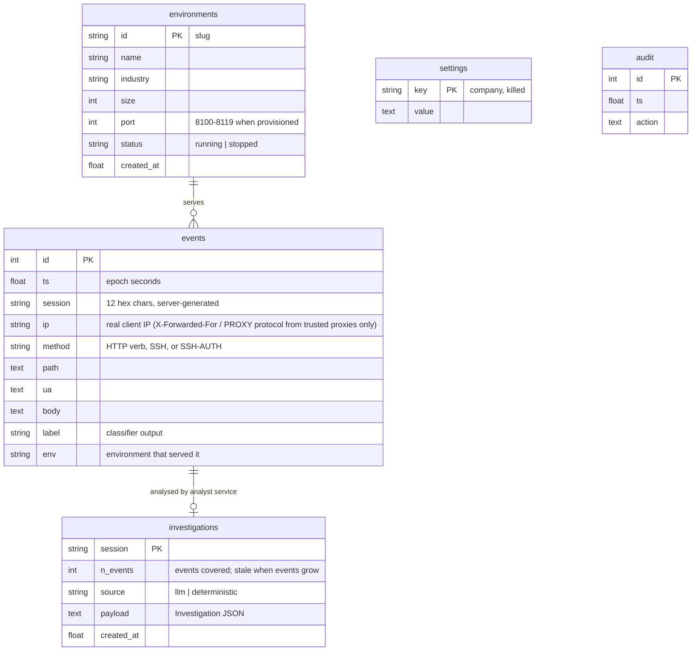

# Database schema (Alembic migrations in `migrations/versions`)

Indexes: `ix_events_session`, `ix_events_ts`. Retention and quota are runtime settings (Settings page): events older than `retention_days` (default 30) are deleted and only the newest `max_events` (default 1,000,000) are kept, hourly and on demand. Attacker-controlled text is stripped of NUL bytes and length-capped before insert.
PostgreSQL roles (created by migrations 0002/0003 when the matching `HIAB_*_DB_PASSWORD` is set):

| Role | Used by | events | investigations | settings | audit |
|---|---|---|---|---|---|
| `hiab` (owner) | `migrate` job only | all | all | all | all |
| `hiab_ingest` | decoy | INSERT only | none | SELECT (also SELECT on `environments`) | none |
| `hiab_control` | control plane | SELECT, DELETE | SELECT | SELECT, INSERT, UPDATE (full CRUD on `environments`) | SELECT, INSERT |
| `hiab_analyst` | analyst service | SELECT | SELECT, INSERT, UPDATE | none | none |
